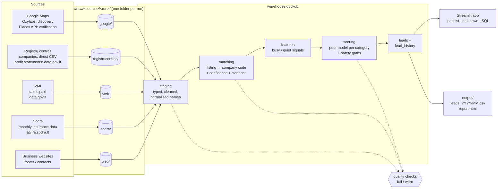
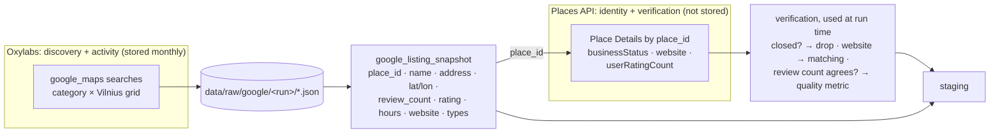
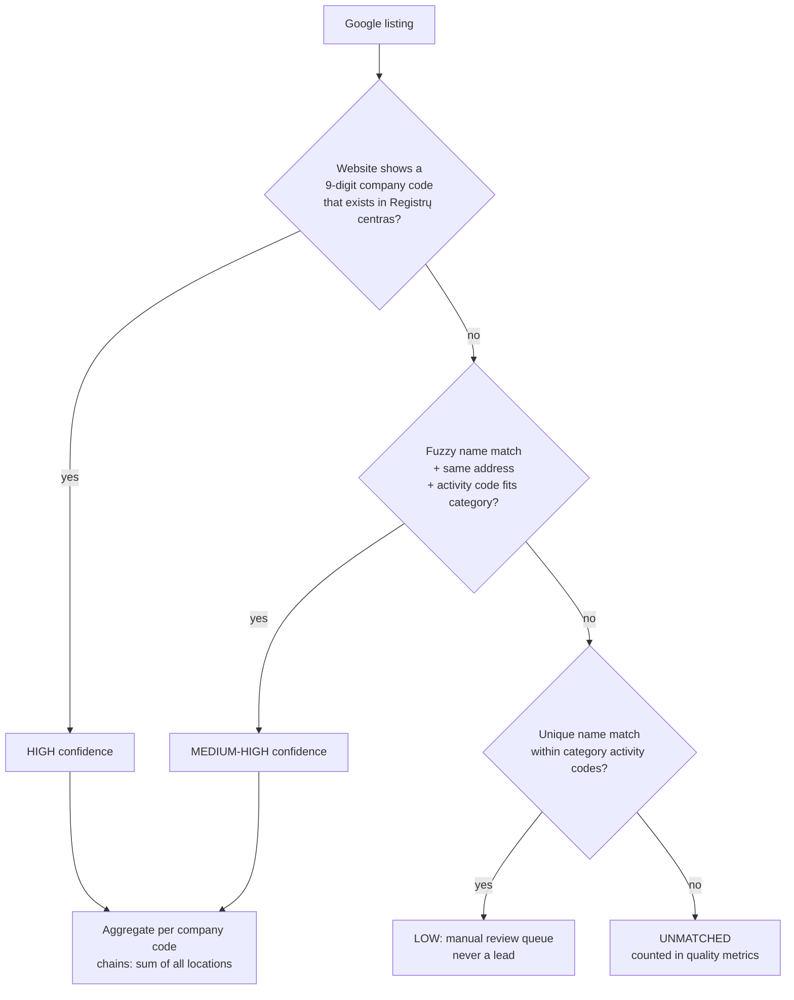
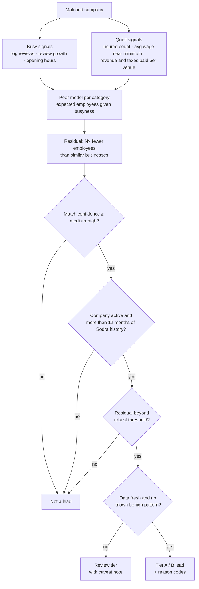
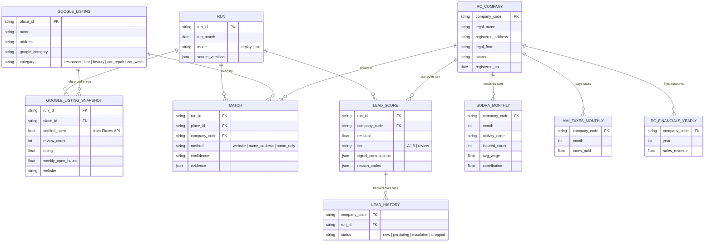

# Architecture

Goal: a monthly, explainable, prioritised list of Vilnius businesses that look
**busy on Google** but **quiet on paper** (official Lithuanian registers), for a
VMI analyst with limited inspection capacity.

## Glossary

| Term | Meaning |
|---|---|
| **Company code** (`company_code`) | 9-digit legal entity code (*juridinio asmens kodas*) assigned by Registrų centras. The join key across all official sources. |
| **Activity code** (`activity_code`) | What the business does, from the **EVRK** classification (*Ekonominės veiklos rūšių klasifikatorius*), the Lithuanian edition of the EU **NACE** classification. E.g. `56.11` = restaurants, `96.21` = hairdressing. Sodra and VMI report it per company; since 2025 it is NACE Rev. 2.1. |
| **Insured count** | Number of people the company pays social insurance for (Sodra `numInsured`), our proxy for declared employees. |
| **Listing** | One Google Maps place (one physical venue). One company can have many listings (chains). |
| **Google providers** | Oxylabs finds venues and their activity; the Google Places API verifies a listing is still open and cross-checks its data. See below. |

## Categories

| Category | Google Maps search / types | Activity codes (EVRK / NACE 2.1) | Vilnius companies in Sodra, 2026-09 |
|---|---|---|---|
| Restaurants & cafés | restaurant, cafe | `56.11` | 670 |
| Bars | bar, pub | `56.30` (many bars are registered as `56.11`) | 69 |
| Hair & beauty salons | hair salon, barber, beauty salon | `96.21`, `96.22` | 89 + 167 |
| Car repair | car repair, auto service | `95.31` | 520 |
| Car washes | car wash | `95.31` (shared with car repair) | in the 520 above |

Car repair and car washes share one activity code, so the Google category, not
the register, decides which of the two a venue belongs to.

## Sources

| Source | Dataset | Access | Refresh | Used for |
|---|---|---|---|---|
| Google Maps | places by category in Vilnius | Oxylabs scraper API (Python) | every run | **visible** activity: reviews, rating, hours, website |
| Google Maps | details for candidate listings | Google Places API (New) | every run | verification: still open, website, review-count cross-check |
| Registrų centras | registered companies (`JAR_IREGISTRUOTI.csv`) | direct download, registrucentras.lt/aduomenys | daily | names, addresses, legal form, status, for matching |
| Registrų centras | deregistered companies (`JAR_ISREGISTRUOTI.csv`) | direct download, registrucentras.lt/aduomenys | daily | flag listings whose company no longer exists |
| Registrų centras | profit/loss statements (`datasets/gov/rc/jar/pelno_ataskaitos`) | data.gov.lt API (published there by Registrų centras; no direct file) | yearly, about 5-month lag | **declared** sales revenue |
| VMI | taxes paid by companies (`datasets/gov/vmi/ja_mokesciai`) | data.gov.lt API | monthly | **declared** taxes paid |
| Sodra | company insurance data (`monthly-YYYY.csv.zip`) | atvira.sodra.lt bulk file | monthly, about 1-month lag | **declared** employees, average wage, activity code |
| Business websites | footer / contacts page | polite HTTP fetch | every run | company code printed on site, for high-confidence matching |

## 1. Pipeline

Two run modes:
- **replay** (default, `docker compose up`): rebuilds everything from a committed, filtered sample of the raw data (Vilnius, our categories only), so it needs no API keys.
- **live**: scrapes fresh data and writes a new `data/raw/<source>/<run>` folder.

### Google providers: two tools, two jobs

| | **Oxylabs** (Web Scraper API, `google_maps`) | **Google Places API (New)** |
|---|---|---|
| Job | **Discovery and visible activity**: find every venue per category across a Vilnius grid; review count, rating, hours, website | **Identity and verification** for listings Oxylabs found: is it still open (`businessStatus`), official website, official review count |
| Why this tool | Results can be kept as monthly history and committed as the example run | Official, stable API with a clean `businessStatus` that scraping lacks; fits the free monthly allowance because we call it only for candidate listings, not for discovery |
| What we store | Full raw response, every run | Only `place_id` (allowed by Google's terms) and derived flags for the current run; raw Places content is not kept long-term |
| If it is unavailable | Run fails: no visible-activity data | Run continues; leads lose the "verified open" flag and drop a tier |

Using the Places API only on listings that are already candidates keeps it in the
free tier and inside its terms, and gives us a second, independent read of review
counts that we report as a data quality metric (how often the two providers agree).

Assumption to verify in the Oxylabs trial: its results carry Google's `place_id`.
If they do not, the Places API lookup falls back to a Text Search on name + address,
and that link gets its own confidence score.

## 2. Matching a listing to a company

## 3. Scoring and safety gates

Leads are leads, not accusations. Every gate exists because a false flag costs an
honest business an inspection, so ambiguous cases drop to *review*, not *lead*.

## 4. Data model

